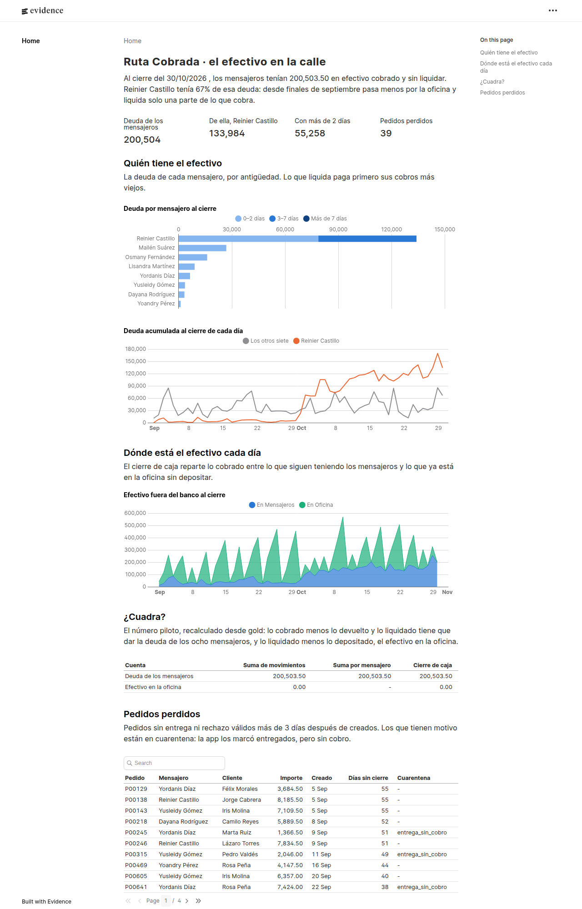
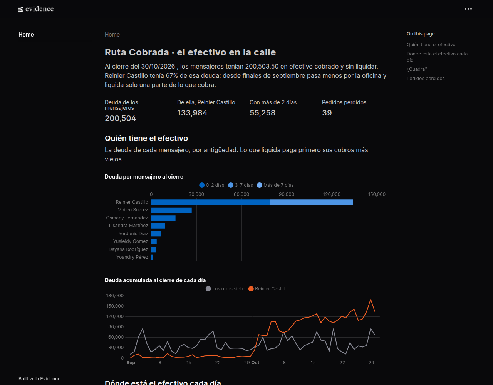

# Ruta Cobrada

[Español](README.md) · **English**

Cash reconciliation for a cash-on-delivery courier service: how much money each courier is holding right now, and why the till does not match what was sold.

The pilot number, which must match to the cent:

> courier debt = collected − settled − refunds

An order refused at the door is never collected; a refund is cash given back to the customer after collecting. The [plan's glossary](docs/plan-sprints.md#glosario) pins down each term.

A bronze → silver → gold pipeline on DuckDB (local) and Dataform on BigQuery, with incremental loads, late-arriving data, SCD type 2 history and data-quality tests.

> **Finding:** at the close of 30 October the couriers hold 200,503.50 not yet settled, and a single one, Reinier Castillo (M05), holds 67 % of it. Since late September, M05 comes to the office less often and settles only part of what is collected.



**Status:** sprint 6 (BI and presentation). The full plan is in [docs/plan-sprints.md](docs/plan-sprints.md).

Code, tables and columns are named in Spanish, the language of the business. The main names: *pedido* (order), *evento* (delivery event), *mensajero* (courier), *liquidación* (cash the courier hands in at the office), *extracto del banco* (bank statement), *deuda* (debt), *cuarentena* (quarantine), *cierre de caja* (daily cash close).

## Sources

The data is synthetic: [generar/generar_datos.py](generar/generar_datos.py) creates it with a fixed seed for 8 couriers and 60 days, with defects planted on purpose.

| File | What it is | Defects |
|---|---|---|
| `pedidos/YYYY-MM-DD.csv` | Store orders, one file per day | An edited order shows up again with a new amount or address |
| `eventos/YYYY-MM-DD.jsonl` | Deliveries, refusals and refunds from the courier app | Duplicated, out of order, 5 % arrive 1 to 4 days late, and some lines break the contract |
| `liquidaciones/YYYY-MM-DD.csv` | The cashier's sheet | The courier's name written several ways, and payments split in two |
| `extracto_banco/YYYY-MM-DD.csv` | Office deposits | One deposit groups several days |
| `verdad.json` | Each courier's real debt at each day's close | Read only by the tests, never by the pipeline |

The generator refuses to write into a folder that already has files, so it never overwrites data.

## Bronze rules

- Bronze keeps each source as it arrived, all as text, with its source file and load time.
- An event that breaks [the contract](contratos/evento.json) goes to `bronze.rechazos_contrato` with its reason, instead of breaking the load or getting lost silently.

## Silver rules

- **Duplicates:** an event repeated with the same `id_evento` counts once; the first copy that arrived wins.
- **Current status:** an order's status comes from its valid event with the latest `ocurrido_en`, not from the last one that arrived.
- **History (SCD type 2):** each version of an order is valid from its `actualizado_en` until the next version, and the collectable amount is the one in force at delivery.
- **Courier aliases:** a name is compared ignoring case, accents and extra spaces, and mapped to its id with [the alias seed](seeds/alias_mensajeros.csv).
- **Quarantine:** anything unusable goes to `silver.cuarentena` with its reason (`entrega_sin_cobro`, `devolucion_sin_entrega`, `pedido_desconocido`, `mensajero_desconocido`, `tipo_desconocido`, `dato_invalido`, `importe_no_positivo`, `fuera_de_ventana`) and never counts as zero.
- **Sources from own systems:** orders and the bank statement come from systems, not people; an invalid type there stops the pipeline instead of hiding in quarantine.

## Gold

- **`gold.deuda_mensajero_dia`:** each courier's debt at each day's close (collected − refunded − settled, cumulative), split by age into 0–2, 3–7 and more than 7 days. What the courier refunds or settles pays off the oldest collections first (FIFO).
- **`gold.cierre_caja`:** per day, what was collected, refunded, settled and deposited, and where the cash is: with the couriers, at the office or in the bank.
- **`gold.pedidos_perdidos`:** orders with no valid delivery or refusal more than 3 days after creation, with their quarantine reason if any.

## Data quality

Each file in [sql/calidad](sql/calidad) returns the rows that break a rule: zero rows means it passes. There are 12, and each one explains itself in its first line. Gold is published to `data/gold/*.parquet` only if all of them pass; if any fails, what was published before stays untouched.

The key test compares `gold.deuda_mensajero_dia` with `verdad.json`: the debt of all 8 couriers on each of the 60 days, to the cent.

## Incremental load

Each source arrives as one file per day, and the daily load only processes what is new:

- **Bronze only appends:** a file is loaded once; `meta.cargas` keeps its name, rows and md5. If an already loaded file changes, the load stops instead of mixing two versions.
- **One SQL file = one table:** the header declares the table (`-- tabla:`) and, if incremental, its key (`-- clave:`). The pipeline deletes and inserts, in one transaction, the rows whose keys the result brings, so repeating a load changes nothing.
- **Reprocessing window:** each load recomputes silver and gold from 5 days back, to absorb late events and refunds whose delivery arrives later.
- **Outside the window:** an event that arrives more than 5 days after it happened does not reopen closed days: it goes to quarantine with the reason `fuera_de_ventana`.

The main test loads the 64 days one by one and checks that every table ends up identical to a full load.

## BigQuery and Dataform

[dataform/](dataform) is the same logic written for BigQuery: one `.sqlx` for each table in `sql/silver` and `sql/gold`, and one assertion for each test in `sql/calidad`.

- **Incremental tables:** the large tables (reviewed events, order history, deposits, debt and cash close) are `incremental` with a `uniqueKey`, so Dataform runs a `MERGE`, and with `when(incremental(), ...)` they recompute the last 5 days, like the local version.
- **Partitions:** events, deposits, debt and cash close are partitioned by date; debt is also clustered by courier. The incremental gold queries filter on their partition column, which is what keeps BigQuery from re-reading the whole table.
- **Bronze:** [cargar_bigquery.py](cargar_bigquery.py) checks events against the contract and loads each file with `--replace` into its day's partition (`bronze.eventos$20260903`), so repeating a day does not duplicate rows. With `--bucket`, files go through Cloud Storage first.

No Google account is needed to check it: [tests/test_dataform.py](tests/test_dataform.py) compiles the project with the Dataform CLI, validates it as BigQuery SQL with sqlglot, translates it to DuckDB and checks that gold and the 12 assertions match the local version, in both a full and an incremental run. What is not tested is running against real BigQuery.

## BI

[bi/](bi) is an [Evidence](https://evidence.dev) page that reads the Parquet files the pipeline publishes in `data/gold/`, so it only shows data that passed the 12 quality tests.

- **Headline:** the couriers' total debt and how much of it the biggest debtor holds.
- **Who holds the cash:** each courier's debt at the close, split into 0–2, 3–7 and more than 7 days, and the late courier's daily debt against the other seven.
- **Where the cash is each day:** what the couriers still hold and what sits at the office not yet deposited.
- **Does it add up?:** the pilot number computed three ways (sum of movements, sum per courier and cash close) must give the same result.
- **Lost orders:** orders still open after 3 days, with their quarantine reason.

### Screenshots

| Light mode (full page) | Dark mode |
|---|---|
|  |  |

The screenshots use the synthetic data from seed 7. The page follows the system theme; in dark mode, Evidence inverts the shades of the age buckets.

## Run it

```bash
uv sync
uv run python generar/generar_datos.py
uv run python pipeline.py                      # full load
uv run python pipeline.py --dia 2026-09-15     # daily load up to that day
uv run pytest

# Dataform (optional; without node_modules its tests are skipped)
cd dataform && npm install && npx dataform compile .

# BI (after pipeline.py)
cd bi && npm install && npm run sources && npm run dev

# BigQuery (needs gcloud and bq with an active session)
uv run python cargar_bigquery.py --proyecto <id> --dia 2026-09-15 --mostrar
```
