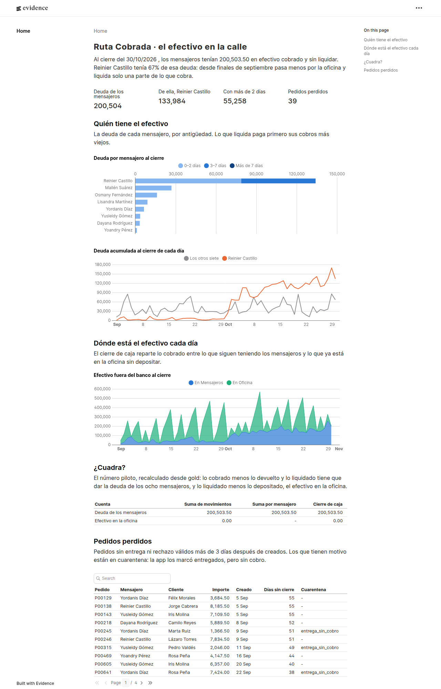
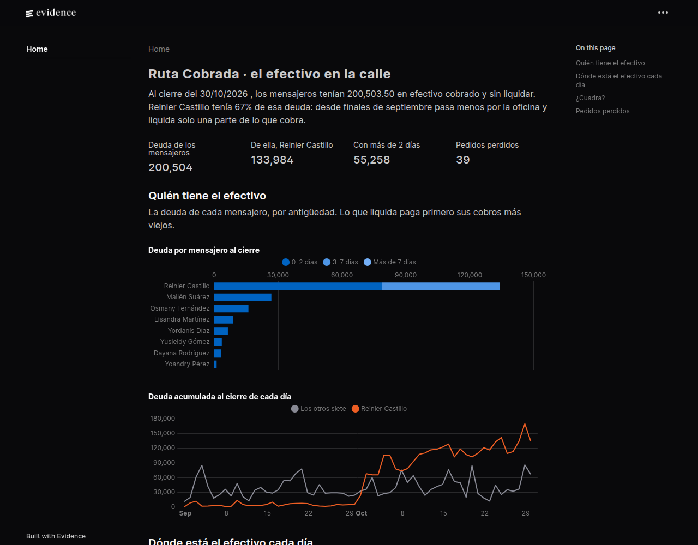

# Ruta Cobrada

**Español** · [English](README.en.md)

Conciliación del efectivo de una mensajería que cobra contra entrega: cuánto dinero tiene cada mensajero ahora mismo y por qué la caja no cuadra con lo vendido.

El número piloto, que debe cuadrar al centavo:

> deuda del mensajero = cobrado − liquidado − devoluciones

Un pedido rechazado en la puerta nunca se cobra; una devolución es efectivo devuelto al cliente después de cobrar. El [glosario del plan](docs/plan-sprints.md#glosario) fija cada término.

Pipeline bronze → silver → gold en DuckDB (local) y Dataform sobre BigQuery, con cargas incrementales, datos que llegan tarde, historial SCD tipo 2 y pruebas de calidad.

> **Hallazgo:** al cierre del 30 de octubre los mensajeros tienen 200 503,50 sin liquidar, y uno solo, Reinier Castillo (M05), tiene el 67 %. Desde finales de septiembre pasa menos por la oficina y liquida solo una parte de lo que cobra.



**Estado:** sprint 6 (BI y presentación). El plan completo está en [docs/plan-sprints.md](docs/plan-sprints.md).

## Fuentes

Los datos son sintéticos: [generar/generar_datos.py](generar/generar_datos.py) los crea con semilla fija para 8 mensajeros y 60 días, con defectos a propósito.

| Archivo | Qué es | Defectos |
|---|---|---|
| `pedidos/AAAA-MM-DD.csv` | Pedidos de la tienda, uno por día | Un pedido editado reaparece con nuevo importe o dirección |
| `eventos/AAAA-MM-DD.jsonl` | Entregas, rechazos y devoluciones de la mensajería | Duplicados, desordenados, un 5 % llega de 1 a 4 días tarde y algunas líneas no cumplen el contrato |
| `liquidaciones/AAAA-MM-DD.csv` | Planilla del cajero | El nombre del mensajero escrito de varias formas y pagos partidos en dos |
| `extracto_banco/AAAA-MM-DD.csv` | Depósitos de la oficina | Un depósito agrupa varios días |
| `verdad.json` | Deuda real de cada mensajero al cierre de cada día | Solo la leen las pruebas, nunca el pipeline |

El generador no escribe en una carpeta que ya tenga archivos, para no pisar datos.

## Reglas de bronze

- Bronze guarda cada fuente tal cual, todo como texto, con el archivo de origen y la hora de carga.
- Un evento que no cumple [el contrato](contratos/evento.json) va a `bronze.rechazos_contrato` con su motivo, en lugar de romper la carga o perderse en silencio.

## Reglas de silver

- **Duplicados:** un evento repetido con el mismo `id_evento` cuenta una vez; vale la primera copia que llegó.
- **Estado vigente:** el estado de un pedido es el de su evento válido con mayor `ocurrido_en`, no el del último que llegó.
- **Historial (SCD tipo 2):** cada versión de un pedido vale desde su `actualizado_en` hasta la versión siguiente, y el importe cobrable es el de la versión vigente al entregar.
- **Alias de mensajeros:** un nombre se compara sin mayúsculas, tildes ni espacios de más, y se traduce a su id con [el seed de alias](seeds/alias_mensajeros.csv).
- **Cuarentena:** lo que no se puede usar va a `silver.cuarentena` con su motivo (`entrega_sin_cobro`, `devolucion_sin_entrega`, `pedido_desconocido`, `mensajero_desconocido`, `tipo_desconocido`, `dato_invalido`, `importe_no_positivo`, `fuera_de_ventana`) y nunca cuenta como cero.
- **Fuentes de sistemas propios:** pedidos y extracto bancario vienen de sistemas, no de personas; un tipo inválido ahí detiene el pipeline en lugar de esconderse en cuarentena.

## Gold

- **`gold.deuda_mensajero_dia`:** la deuda de cada mensajero al cierre de cada día (cobrado − devuelto − liquidado, acumulado), repartida por antigüedad en 0–2, 3–7 y más de 7 días. Lo que el mensajero devuelve o liquida paga primero sus cobros más viejos (FIFO).
- **`gold.cierre_caja`:** por día, lo cobrado, devuelto, liquidado y depositado, y dónde está el efectivo: en los mensajeros, en la oficina o en el banco.
- **`gold.pedidos_perdidos`:** pedidos sin entrega ni rechazo válidos más de 3 días después de creados, con el motivo de cuarentena si lo hay.

## Calidad

Cada archivo de [sql/calidad](sql/calidad) devuelve las filas que rompen una regla: cero filas significa que pasa. Hay 12, y cada una se explica en su primera línea. Gold solo se publica en `data/gold/*.parquet` si pasan todas; si alguna falla, lo publicado antes queda intacto.

La prueba clave compara `gold.deuda_mensajero_dia` con `verdad.json`: la deuda de los 8 mensajeros en cada uno de los 60 días, al centavo.

## Carga incremental

Cada fuente llega en un archivo por día, y la carga diaria solo procesa lo nuevo:

- **Bronze solo agrega:** un archivo se carga una vez; `meta.cargas` guarda su nombre, filas y md5. Si un archivo ya cargado cambia, la carga se detiene en lugar de mezclar dos versiones.
- **Un archivo SQL = una tabla:** la cabecera declara la tabla (`-- tabla:`) y, si es incremental, su clave (`-- clave:`). El pipeline borra e inserta en una transacción las filas cuyas claves trae el resultado, así que repetir una carga no cambia nada.
- **Ventana de reproceso:** cada carga recalcula silver y gold desde 5 días antes, para absorber los eventos que llegan tarde y las devoluciones cuya entrega llega después.
- **Fuera de ventana:** un evento que llega más de 5 días después de ocurrir no reabre días cerrados: va a cuarentena con el motivo `fuera_de_ventana`.

La prueba principal carga los 64 días uno a uno y comprueba que todas las tablas quedan idénticas a las de una carga completa.

## BigQuery y Dataform

[dataform/](dataform) es la misma lógica escrita para BigQuery: un `.sqlx` por cada tabla de `sql/silver` y `sql/gold`, y una aserción por cada prueba de `sql/calidad`.

- **Incrementales:** las tablas grandes (eventos revisados, historial de pedidos, depósitos, deuda y cierre) son `incremental` con `uniqueKey`, así que Dataform hace un `MERGE`, y con `when(incremental(), ...)` recalculan los últimos 5 días, como la versión local.
- **Particiones:** eventos, depósitos, deuda y cierre se particionan por fecha; la deuda, además, se agrupa por mensajero. Las consultas incrementales de gold filtran por su columna de partición, que es lo que evita releer toda la tabla en BigQuery.
- **Bronze:** [cargar_bigquery.py](cargar_bigquery.py) revisa los eventos contra el contrato y carga cada archivo con `--replace` en la partición de su día (`bronze.eventos$20260903`), así que repetir un día no duplica filas. Con `--bucket`, pasa antes por Cloud Storage.

No hace falta cuenta de Google para comprobarlo: [tests/test_dataform.py](tests/test_dataform.py) compila el proyecto con la CLI de Dataform, valida que es SQL de BigQuery con sqlglot, lo traduce a DuckDB y comprueba que gold y las 12 aserciones dan lo mismo que la versión local, tanto en una ejecución completa como en una incremental. Lo que no está probado es la ejecución contra BigQuery real.

## BI

[bi/](bi) es una página de [Evidence](https://evidence.dev) que lee los Parquet que publica el pipeline en `data/gold/`, así que solo muestra datos que pasaron las 12 pruebas de calidad.

- **Titular:** la deuda total de los mensajeros y cuánto de ella tiene el que más debe.
- **Quién tiene el efectivo:** la deuda de cada mensajero al cierre, partida en 0–2, 3–7 y más de 7 días, y la deuda diaria del mensajero atrasado frente a los otros siete.
- **Dónde está el efectivo cada día:** lo que siguen teniendo los mensajeros y lo que está en la oficina sin depositar.
- **¿Cuadra?:** el número piloto calculado de tres formas (suma de movimientos, suma por mensajero y cierre de caja) tiene que dar lo mismo.
- **Pedidos perdidos:** los pedidos sin cierre después de 3 días, con su motivo de cuarentena.

### Capturas

| Modo claro (página completa) | Modo oscuro |
|---|---|
|  |  |

Las capturas usan los datos sintéticos de la semilla 7. La página sigue el tema del sistema; en oscuro, Evidence invierte los tonos de los tramos de antigüedad.

## Ejecutar

```bash
uv sync
uv run python generar/generar_datos.py
uv run python pipeline.py                      # carga completa
uv run python pipeline.py --dia 2026-09-15     # carga diaria hasta ese día
uv run pytest

# Dataform (opcional; sin node_modules sus pruebas se saltan)
cd dataform && npm install && npx dataform compile .

# BI (después de pipeline.py)
cd bi && npm install && npm run sources && npm run dev

# BigQuery (necesita gcloud y bq con sesión iniciada)
uv run python cargar_bigquery.py --proyecto <id> --dia 2026-09-15 --mostrar
```
